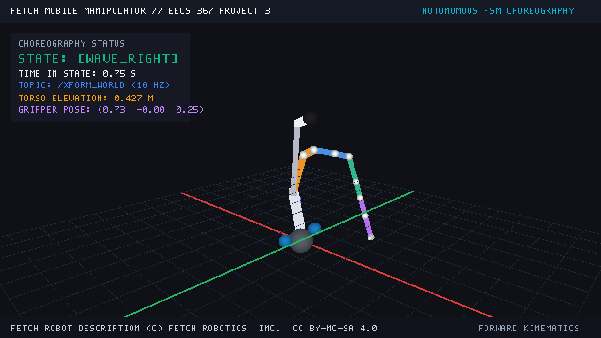
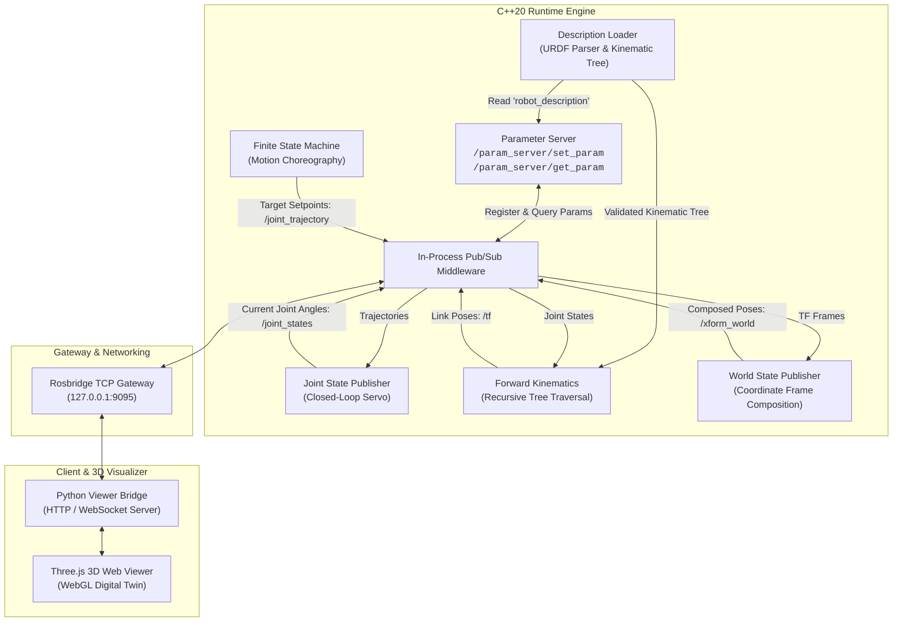

# Autonomous Robotic Manipulator & Kinematics Runtime


A high-performance robotics runtime and motion execution engine implemented in modern **C++20** from first principles. The system includes custom 3D spatial transformation mathematics, URDF parsing and kinematic tree validation, recursive forward kinematics, global coordinate composition, closed-loop joint servoing, and a finite state machine (FSM) motion orchestrator. 

It is paired with a real-time **Three.js / WebGL 3D visualizer** communicating over an asynchronous TCP/JSON gateway, demonstrated on an autonomous **7-DOF chess manipulator arm** executing a pick-and-place chess sequence.

---



---

## Key Highlights & What Was Built

- **Zero-Dependency 3D Math & Kinematics Engine**: Implemented entirely from scratch without external libraries (no KDL, Pinocchio, MoveIt, tf2, or Eigen). Includes 3D vectors, unit quaternions (Hamilton product, axis-angle, Euler roll-pitch-yaw conversions, slerp), and 4x4 column-major homogeneous transformation matrices.
- **URDF Parser & Tree Topology Validator**: Fast XML parsing (`pugixml`) that extracts links, joint limits, visual geometric primitives (boxes, cylinders, spheres), materials, and origin transforms. Automatically identifies root frames, verifies acyclicity, and enforces valid tree topologies.
- **Recursive Forward Kinematics (FK)**: Traverses kinematic trees from the root link to evaluate arbitrary joint configurations, dynamically composing joint motions ($T_{\text{link}} = T_{\text{origin}} \cdot T_{\text{motion}}(q_j)$) across revolute, continuous, and prismatic joints.
- **World-State Composition Engine**: Composes tree transforms with global root offsets into unified world coordinate frames ($T_{\text{world}} = T_{\text{global}} \cdot T_{\text{parent}} \cdot T_{\text{child}}$), streaming 16-element column-major matrices on `/xform_world` at 10 Hz.
- **Closed-Loop Joint Servoing**: Subscribes to `/joint_trajectory` setpoints and smoothly servos multi-joint positions under velocity constraints toward target configurations, publishing real-time states to `/joint_states`.
- **Finite State Machine (FSM) Choreography**: A configurable, event-driven state machine coordinating multi-stage manipulation routines based on joint tolerances ($\epsilon \le 0.03$), dwell times, and transition triggers.
- **High-Throughput Middleware & Network Gateway**: Thread-safe publish-subscribe broker and synchronous parameter service registry with an asynchronous TCP socket server implementing the Rosbridge v2 JSON protocol and dynamic line buffering for megabyte-scale URDF payloads.
- **Interactive 3D WebGL Digital Twin**: Three.js browser visualizer streaming 60 FPS link poses over TCP with smooth quaternion slerp interpolation, orbit controls, coordinate frames, and live joint monitoring.

---

## System Architecture

The runtime operates as a modular, multithreaded node graph communicating over an internal publish-subscribe and RPC broker:



### Node Responsibilities

| Component | File | Responsibility |
| :--- | :--- | :--- |
| **`math3d`** | `src/math3d.cpp` | Custom 3D vectors, unit quaternions, Euler RPY, Hamilton product, and 4x4 matrix transforms. |
| **`robot_model`** | `src/robot_model.cpp` | URDF XML parsing, geometry extraction, parent-child graph assembly, and tree acyclicity validation. |
| **`forward_kinematics`** | `src/forward_kinematics.cpp` | Recursive traversal computing root-relative link frames for revolute, prismatic, and continuous joints. |
| **`robot_description_loader`**| `src/robot_description_loader.cpp` | Manages runtime URDF loading, description status updates, and dynamic model hot-swapping. |
| **`robot_world_state_publisher`**| `src/robot_world_state_publisher.cpp` | Composes local TF trees with world origins; publishes 16-element column-major matrices on `/xform_world`. |
| **`joint_state_publisher`** | `src/joint_state_publisher.cpp` | Velocity-bounded trajectory interpolation and 10 Hz `/joint_states` publisher. |
| **`finite_state_machine`** | `src/finite_state_machine.cpp` | JSON-driven state machine orchestrating multi-joint trajectories, arrival tolerances, and transitions. |
| **`rosbridge_server`** | `include/middleware/rosbridge_server.hpp` | High-throughput non-blocking TCP socket server handling Rosbridge v2 JSON messaging. |

---

## Kinematics & Math Formulation

All spatial calculations are derived from first principles:

### 1. Homogeneous Matrix Representation
A rigid spatial transform relating parent link frame $A$ to child link frame $B$ is represented as a $4 \times 4$ column-major matrix:

$$T = \begin{bmatrix} R & \mathbf{p} \\ \mathbf{0}^T & 1 \end{bmatrix} \in \mathrm{SE}(3)$$

Stored contiguously in memory as `Matrix4::data[4 * c + r]`.

### 2. Quaternion & Rotation Conversions
Rotations are handled via unit quaternions $\mathbf{q} = (w, x, y, z)$ to avoid gimbal lock:
- **Axis-Angle to Quaternion**:
  $$\mathbf{q} = \left(\cos\frac{\theta}{2},\; \mathbf{u} \sin\frac{\theta}{2}\right)$$
- **Euler Angles ($Z$-$Y$-$X$ Roll-Pitch-Yaw)**:
  Composed via sequential Hamilton quaternion multiplication:
  $$\mathbf{q} = \mathbf{q}_z(\psi) \cdot \mathbf{q}_y(\theta) \cdot \mathbf{q}_x(\phi)$$

### 3. Forward Kinematics Tree Recursion
For each joint $j$ connecting parent link $P$ to child link $C$:
$$T_{\text{world} \to C} = T_{\text{world} \to P} \cdot T_{\text{origin}, j} \cdot T_{\text{motion}, j}(q_j)$$

- **Revolute / Continuous Joints**: Rotation $R_{\mathbf{a}_j}(q_j)$ about joint axis $\mathbf{a}_j$.
- **Prismatic Joints**: Linear translation $\mathbf{p} = \mathbf{a}_j \cdot q_j$.
- **Fixed Joints**: Identity motion transform ($T_{\text{motion}} = I_4$).

---

## Demonstration: Autonomous Chess Manipulation

The showcase demonstration features a custom **7-DOF Articulated Chess Manipulator Arm** mounted beside a regulation 8x8 chessboard:

- **Scene Complexity**: 18 links and 17 joints, including a base turntable, 5-axis articulated arm, and a dual-jaw parallel gripper with high-friction finger pads.
- **Chessboard Workstation**: Regulation 64-square checkered board with multi-piece scene models (pawns, kings, knights).
- **Choreography**: The King's Pawn Opening (**1. e4 pick-and-place**) decomposed into 9 sequential FSM states:

```
  [1. home] ──────────► [2. hover_e2] ─────────► [3. descend_e2]
      ▲                                                │
      │                                                ▼
  [9. retract_ascent]                            [4. grasp_pawn]
      ▲                                                │
      │                                                ▼
  [8. release_pawn] ◄── [7. place_on_e4] ◄─────── [6. carry_to_e4] ◄── [5. lift_pawn]
```

1. **`home`**: Standby pose elevated over the board with gripper jaws open.
2. **`hover_e2`**: Trajectory positioning the end-effector directly above the pawn at square e2.
3. **`descend_e2`**: Vertical descent aligning gripper fingers around the pawn body.
4. **`grasp_pawn`**: Prismatic inward actuation clamping the pawn securely.
5. **`lift_pawn`**: Vertical ascent clearing neighboring board pieces (+10 cm).
6. **`carry_to_e4`**: Coordinated 5-axis trajectory transporting the pawn to square e4.
7. **`place_on_e4`**: Smooth vertical descent setting the piece flush onto target square e4.
8. **`release_pawn`**: Gripper jaws open to full clearance.
9. **`retract_ascent`**: Safe vertical climb returning to the standby home position.

> The runtime also maintains full compatibility with external industrial models, such as the 14-DOF **Fetch Mobile Manipulator** (`fetch_dance.json`).

---

## Interactive 3D Web Visualizer

The project includes an interactive browser-based 3D digital twin:
- **WebGL Rendering**: Three.js renderer featuring soft shadows, directional lighting, and realistic material shading.
- **Smooth Interpolation**: Dual-buffer pose slerp interpolation providing 60 FPS visual continuity even with modest network broadcast rates.
- **Real-Time Control**: Live trajectory speed multiplier (0.2x–2.5x), camera orbit presets, coordinate axis toggles, and state machine status indicator.

---

## Project Structure

```
.
├── Makefile                      # Build automation & test targets
├── include/
│   ├── finite_state_machine.hpp  # FSM motion coordinator
│   ├── forward_kinematics.hpp    # Recursive kinematic tree engine
│   ├── joint_state_publisher.hpp # Closed-loop trajectory servo
│   ├── math3d.hpp                # Vectors, quaternions, 4x4 matrix transforms
│   ├── parameter_server.hpp      # Dynamic configuration & parameter store
│   ├── robot_description_loader.hpp # URDF loader & lifecycle manager
│   ├── robot_model.hpp           # Kinematic graph & link/joint representations
│   ├── robot_world_state_publisher.hpp # World-state composition
│   └── middleware/
│       ├── json.hpp              # High-efficiency JSON parser
│       ├── middleware.hpp        # In-process pub/sub topic broker
│       └── rosbridge_server.hpp  # Rosbridge v2 TCP server
├── src/
│   ├── finite_state_machine.cpp
│   ├── forward_kinematics.cpp
│   ├── joint_state_publisher.cpp
│   ├── main.cpp                  # Main entry point & node initializer
│   ├── math3d.cpp
│   ├── robot_description_loader.cpp
│   ├── robot_model.cpp
│   └── robot_world_state_publisher.cpp
├── fsm/
│   ├── chess_pick_and_place.json # 9-phase chess move choreography
│   ├── fetch_dance.json          # Complex multi-DOF trajectory choreography
│   └── arm_wave.json             # Diagnostic oscillatory motion
├── urdf-files/
│   ├── chess_arm.urdf            # 7-DOF articulated arm & chessboard model
│   └── primitive_bot.urdf        # Benchmark kinematic validation model
├── web/                          # Three.js 3D web visualizer
│   ├── index.html
│   ├── viewer.js
│   └── viewer.css
├── scripts/
│   ├── demo_portfolio.py         # Automated one-command interactive demo launcher
│   ├── generate_portfolio_video.py # High-res headless demo recorder
│   └── viewer.py                 # HTTP and TCP-to-viewer bridge
├── portfolio/                    # Showcase page, video recordings & poster
│   ├── index.html
│   ├── poster.png
│   └── chess_arm_choreography.mp4
└── tests/                        # Comprehensive C++ unit test suite
    ├── finite_state_machine_test.cpp
    ├── forward_kinematics_test.cpp
    ├── joint_state_publisher_test.cpp
    ├── math3d_test.cpp
    ├── robot_model_test.cpp
    ├── robot_state_publisher_test.cpp
    ├── topic_lifecycle_test.cpp
    └── world_state_publisher_test.cpp
```

---

## Getting Started

### Prerequisites

- **C++ Compiler**: GCC (`g++`) $\ge$ 11.0 or Clang $\ge$ 13.0 with C++20 support
- **Build System**: GNU `make`
- **Scripting & Demo Bridge**: Python 3.8+ (standard library only; no external pip dependencies needed)
- **Web Browser**: Modern browser with WebGL enabled (Chrome, Firefox, Safari, Edge)

### Compilation

Build the C++ runtime executable:

```bash
make build
```

This compiles the binary `main` with `-std=c++20 -O2 -pthread`.

### Running the System

#### 1. Interactive Portfolio Demo (Recommended)
Launches the C++ demo runtime, initializes the 3D viewer server, automatically loads the 7-DOF Chess Manipulator Arm URDF, starts the King's Pawn Opening FSM, and opens the visualizer in your default browser:

```bash
make demo-portfolio
```

#### 2. Headless Runtime
To run the pure C++ communication hub and Rosbridge gateway:

```bash
# Standard runtime
make run

# Demo runtime (enables joint servo and FSM nodes)
make demo
```

The gateway listens on `127.0.0.1:9095`.

#### 3. Standalone 3D Robot Viewer
To run the visualizer bridge without starting the automated demo:

```bash
make viewer
# Open http://localhost:8092 in your browser
```

---

## Running Unit Tests

The test suite exercises 3D math correctness, quaternion rotations, XML/URDF parsing, recursive kinematics calculations, parameter server services, topic lifecycles, and state machine transition logic:

```bash
make test
```

All 9 test suites run sequentially:
```
./build/robot_model_test
./build/math3d_test
./build/forward_kinematics_test
./build/robot_description_loader_test
./build/robot_state_publisher_test
./build/topic_lifecycle_test
./build/world_state_publisher_test
./build/joint_state_publisher_test
./build/finite_state_machine_test
```

---

## Technical Specifications

- **Language Standard**: C++20 (`-std=c++20`)
- **Concurrency**: C++ standard threads (`std::thread`, `std::atomic`, `std::mutex`, `std::condition_variable`)
- **Networking**: POSIX non-blocking TCP sockets, Rosbridge v2 JSON protocol
- **Front-End / Visualizer**: WebGL, Three.js (r128), HTML5, CSS3
- **Kinematics Engine**: Custom tree recursion, zero third-party math or physics dependencies
